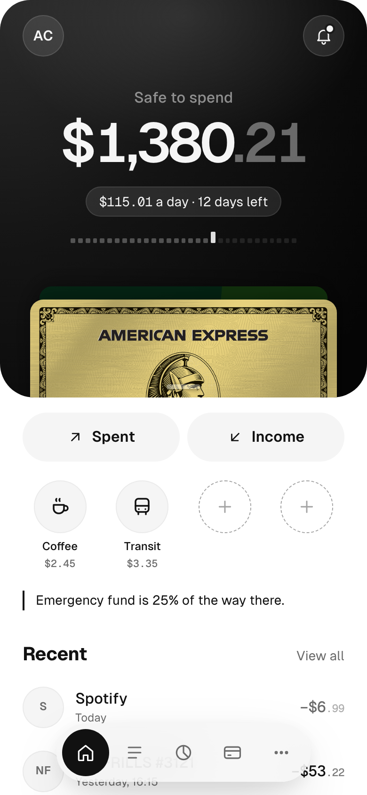
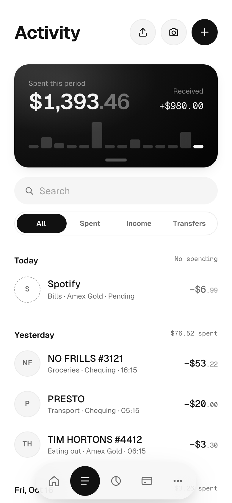
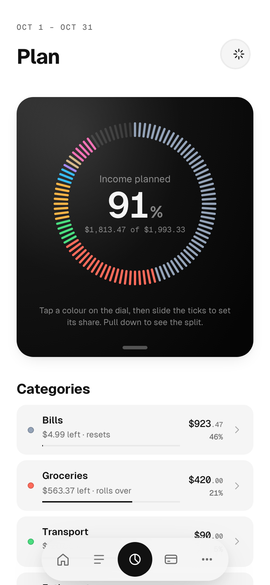
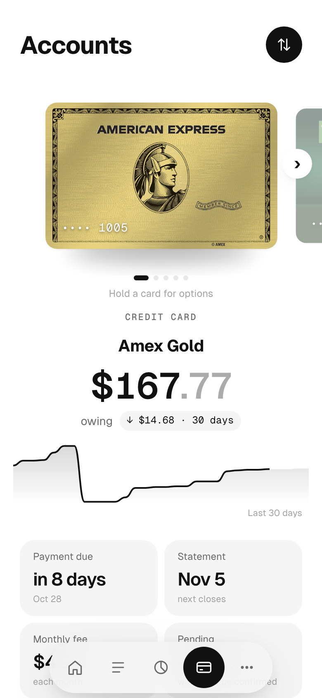

<p align="center">
    
</p>
<h1 align="center">
    Tameru 
</h1>
<p align="center">
    A locally hosted PWA (progressive web app) based budgeting app, always free, always safe, always reliable.
</p>
<p align='center'>
  <a href="https://github.com/sjapanwala/tameru/stargazers"></a>
</p>
<p align="center">
           
</p>
<p align="center">
    <a href="https://app.tameru.cc"><b>Open the app</b></a> · <a href="https://tameru.cc">tameru.cc</a>
</p>


## What is Tameru? 🙋‍♂️

**貯める (tameru)** is Japanese for *to save up*.

Tameru takes your pay, bills, card balances and savings goals and turns them into one number: **how much is safe to spend today** without coming up short. It lives on your phone's Home Screen like any other app, but it's a web app. There's no app store, no account and no bank login, and everything you enter stays on your device.

<p align="center">
    &nbsp;
    &nbsp;
    &nbsp;
    
</p>
<p align="center"><sub>Home · Plan · Activity · Accounts, shown with the app's built-in sample data</sub></p>


## What it does ✨

- **Safe to spend:** one number on Home, split into a daily amount until your next pay. Tap it to see the math.
- **Plan:** your income is a dial of 100 ticks. Give every category, goal and bill a share, in dollars or as a percentage.
- **Bills and paydays:** the next two weeks at a glance. Charges that repeat get spotted and offered as bills.
- **Quick adds:** four slots on Home for the things you buy every week. One tap and it's logged.
- **Receipts:** snap a photo and Tameru reads the store, total, card and date **on your phone**. Nothing is uploaded.
- **Every account:** chequing, savings with interest, credit cards with real card art, due dates and fees, TFSA, cash.
- **Goals:** savings targets with dates, milestones and a contribution each period.
- **Fresh start:** been away a while? Start again from today's balances and keep your history.
- **Lock:** passcode and Face ID.
- **Your data, exportable:** a backup file, CSV export and calendar events for bills and paydays.
- **Stays up to date:** new versions install in the background and swap in when you switch away.


## How the number works 🧮

Every time you open the app, Tameru does the subtraction for you:

```text
              TAMERU · SAFE TO SPEND
               12 days to payday
--------------------------------------------
  Chequing + cash                   2,206.40
  Pay still coming                   +980.00
  Bills to come                      −893.48
  Goals left this period             −100.00
  Still planned in categories        −712.71
  Buffer                             −100.00
--------------------------------------------
  SAFE TO SPEND                    $1,380.21
           $115.01 a day · 12 days
```

Pay that varies counts at its low end, and bills that vary count at their high end. Money already planned for a category, a goal or a bill comes off first, so what's left is yours to spend.


## Private by design 🔒

- **No servers holding your data.** Everything lives in your browser's storage (IndexedDB) on your phone.
- **No sign-up and no bank connection.** You enter balances once and log spending yourself.
- **Works offline.** The app is cached on the device at install. Card art and the receipt reader (Tesseract, bundled with the app, never a CDN) are kept after their first use.
- **Backups are files you keep.** Export from More → Settings, restore on a new phone.


## Get it on your phone 📲

1. Open **[app.tameru.cc](https://app.tameru.cc)** in Safari on iPhone, or Chrome on Android.
2. Tap **Share → Add to Home Screen**. On Android, tap **Install**.
3. Answer a few questions about your pay, bills and goals. You get your first plan and your number right away.


## Run it locally 🛠️

You need Node 20 or newer.

```bash
npm install
npm run dev          # the app at http://localhost:5173
npm run dev:gate     # same, but shows the install page like a browser tab would
npm test             # unit and integration tests (Vitest)
npm run typecheck
npm run build        # production build into dist/
```

Outside an installed PWA the app shows its install page. Add **`?dev=1`** to the URL to run it in a normal tab. That also unlocks the **Debug** screen (`#/debug`), where you can fake today's date, jump ahead in time, and **replace everything with sample data**.


## Project layout 🗂️

```text
src/
  domain/     pure money logic: safe to spend, budgets, periods, recurrence, receipt parsing (+ tests)
  services/   the app's operations on top of the domain: plan, accounts, recurring, receipts, backups
  data/       IndexedDB (Dexie) repositories, the on-device OCR, sample data
  ui/         Preact screens and components, styles and design tokens
  pwa/        install gate, service worker updates, iOS quirks
  copy/       every string the app shows
cards/        card art catalog, by institution
site/         the product site at tameru.cc (static HTML)
scripts/      tooling, e.g. cleaning up card art
tests/        integration tests against a fake IndexedDB
```


## Built with 🧰

[Preact](https://preactjs.com) · [Vite](https://vitejs.dev) + [vite-plugin-pwa](https://vite-pwa-org.netlify.app) · [Dexie](https://dexie.org) · [Tesseract.js](https://tesseract.projectnaptha.com) · [Vitest](https://vitest.dev) · [Geist](https://vercel.com/font) · Cloudflare Workers


## Deploying 🚀

Pushing to `main` deploys both projects on Cloudflare Workers:

| What | Where | From |
|---|---|---|
| The app | [app.tameru.cc](https://app.tameru.cc) | the repo root (`npm run build` → `dist/`) |
| The product site | [tameru.cc](https://tameru.cc) | `site/` (static files in `site/public`) |

Bump the version in `package.json` with each release. It shows in the app under **More**, and an "Updated to vX" note appears on the phone after the new build swaps in.


<p align="center">
    
</p>
